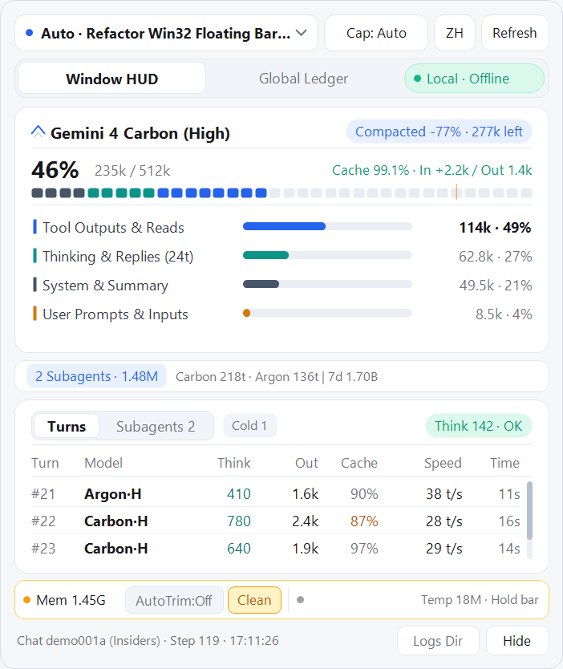
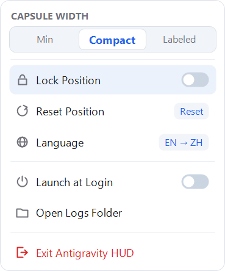

# Antigravity HUD

**Native Windows floating HUD & local token ledger for Google Antigravity.**

English | [简体中文](README.zh-CN.md)

[](https://github.com/CHANPAJN/antigravity-hud)
[](LICENSE)
[-10B981?style=flat-square)](#quick-start)

> **Windows Only · Built for One Single Purpose: Never Touch the Client** — The **only reason** this tool exists as an external overlay is to keep your official Google Antigravity client **100% intact and spotless**: zero `app.asar` patching, zero injected UI panels, zero IDE extensions, zero network calls, and zero credential access. Pure C# Win32 (~236 KB), zero third-party dependencies.

<p align="center">
  
</p>

<p align="center">
  
  &nbsp;
  
  &nbsp;
  
  &nbsp;
  
</p>

<p align="center">
  <br/>
  <sub>Default light mode shown above · Native Windows Dark Mode also built in (follows system theme by default, or switch <code>Auto / Light / Dark</code> anytime in the right-click menu).</sub>
</p>

---

## Features

- **Keep Antigravity Untouched**: No injected UI panels, no `app.asar` modification, no extra IDE extensions cluttering your workspace — works across Antigravity Main, Insiders, and CLI simultaneously.
- **Floating Capsule Bar (Smart Free-Space Placement + Long-Press to Move)**
  - **Smart Auto-Placement**: detects Windows 11 centered vs. left-aligned taskbars and Widgets state — prefers the open **left taskbar slot** on Win11 centered taskbars, uses the right slot on Win10/left-aligned taskbars, and automatically floats cleanly just above the taskbar on compact laptop screens so it never covers your app icons or system tray.
  - **Click** to toggle the detailed HUD & ledger panel without stealing focus from Antigravity.
  - **Long-press (≥ 260 ms) or drag** to freely move the capsule anywhere across single or multiple monitors.
  - **Modern Right-Click Flyout**: native Win11 rounded menu with inline 3-way switchers for capsule width (`Min` / `Compact` / `Labeled`) and appearance (`Auto` / `Light` / `Dark`), plus position lock toggle, one-click reset, `EN / ZH` toggle, login autostart toggle, and logs folder shortcut.
- **Native Windows Light & Dark Theme**
  - Defaults to **`Auto`** (tracks `SystemUsesLightTheme` for the floating capsule and `AppsUseLightTheme` for the popup & menu in real time) with a clean light palette and a neutral graphite dark palette; override anytime from the right-click menu.
  - **Smart Edge & Taskbar Snapping**: magnetically snaps to screen edges and the Windows taskbar centerline (hold `Alt` while dragging for pixel-level fine placement).
  - **Drift-Free Anchoring**: remembers left/right screen alignment in `%LOCALAPPDATA%\AntigravityHUD\config.json` so dynamic capsule width changes never shift off-screen.
  - **Smart Popup Placement**: automatically opens above the bar near the taskbar, flips below when placed near the top of a display, and stays clamped inside the active monitor's working area.
  - **Lock & Reset**: right-click the capsule anytime to lock position against accidental drags or reset back to the default taskbar slot.
- **Window HUD (Active Session Telemetry)**
  - Tracks the active Google Antigravity / Antigravity Insiders / Antigravity CLI window automatically via lightweight Win32 foreground hooks.
  - Context window usage ring (`Auto` / `256K` / `1M` scale), prompt cache hit rate, live generation speed (`t/s`), reasoning depth badge, context breakdown (`Tool Outputs`, `Thinking & Replies`, `System Base`, `User Prompts`), turn-by-turn history, and subagent inspection.
- **Global Ledger (Offline Multi-Day Analytics)**
  - Aggregates local transcript logs across `Today`, `Yesterday`, `7 Days`, `30 Days`, and `All` views.
  - Interactive 7-day bar chart, model breakdown with click-to-drill-down diagnostics, conversation rankings (including subagent totals), and top tool call statistics.
- **Quick Commands (Official Slash Commands · Clipboard Only)**
  - Dedicated 3rd tab listing official Antigravity slash commands (`/btw`, `/compact`, `/goal`, `/teamwork`, `/boost`, `/plan`, `/grill-me`, `/browser`, `/schedule`, `/learn`) with bilingual descriptions.
  - **Pure clipboard copy only** (never simulates keystrokes or injects into the client): click once to copy, auto-hides smoothly so focus returns to Antigravity for instant `Ctrl+V`. Dynamically highlights `/compact` when context usage reaches `≥ 75%`.
- **Bilingual UI (`EN` / `中文`)**
  - Automatically follows Windows UI language on first launch and switches live between English and Simplified Chinese with one click in the top bar or context menu.
- **Optional Memory Helper (Opt-In Only)**
  - Displays read-only Antigravity memory footprint (`WorkingSet`).
  - Manual **Trim / Clean** and **Auto Guard** are **disabled by default** — never runs automatic cleanup unless explicitly toggled on by the user.

---

## Quick Start

### Option 1: Build & Install from Source (Zero External Dependencies)

Every Windows 10 / 11 machine already ships with the built-in .NET Framework 4.x compiler (`csc.exe`). You do **not** need Visual Studio, .NET SDK, or Node.js.

```powershell
git clone https://github.com/CHANPAJN/antigravity-hud.git
cd antigravity-hud

# Compile locally (~1 second) and install to %LOCALAPPDATA%\AntigravityHUD
powershell -ExecutionPolicy Bypass -File .\scripts\install.ps1

# Optional: also enable launch at Windows login (opt-in)
powershell -ExecutionPolicy Bypass -File .\scripts\install.ps1 -Autostart
```

Or simply double-click `build.cmd` to compile a standalone portable `dist\AntigravityHUD.exe` (~215 KB) and run it directly.

### Option 2: Prebuilt Release

Download `AntigravityHUD.exe` and `SHA256SUMS.txt` from [GitHub Releases](https://github.com/CHANPAJN/antigravity-hud/releases) (built directly from this repository on GitHub-hosted `windows-latest` runners).

### Uninstall

```powershell
powershell -ExecutionPolicy Bypass -File .\scripts\uninstall.ps1
```

Cleanly closes the running instance, removes the optional `HKCU\...\Run` entry, Start Menu shortcut, binary, and config file (pass `-KeepConfig` to preserve your saved position and preferences).

---

## Controls & Gestures

| Action | Behavior |
| --- | --- |
| **Left-click capsule** | Expand / collapse the HUD & Global Ledger popup |
| **Long-press (≥ 260 ms) & drag capsule** | Freely move to any position on any monitor (with edge & taskbar snap) |
| **Hold `Alt` while dragging** | Temporarily disable magnetic snapping for exact placement |
| **Right-click capsule** | Lock position, reset to taskbar default, switch `EN/中文`, trim memory, toggle autostart, exit |
| **Click `EN` / `ZH` in header** | Toggle English / Simplified Chinese immediately |
| **`Esc` or click outside popup** | Dismiss the expanded panel |

---

## How It Works & Operational Transparency

Antigravity HUD is designed to be auditable from top to bottom in plain C# source code:

1. **Pure Local Read-Only Log Parsing (Zero Network Calls)**:
   - Reads only local session transcript and annotation files under:
     - `%USERPROFILE%\.gemini\antigravity\brain\`
     - `%USERPROFILE%\.gemini\antigravity-insiders\brain\`
     - `%USERPROFILE%\.gemini\antigravity-cli\brain\`
   - Uses `mtime` + incremental byte-offset tracking so idle disk I/O stays near zero.
   - Makes **zero outbound HTTP/TCP connections**, never inspects browser cookies, OAuth tokens, or API keys, and **never modifies** Antigravity binaries or `app.asar`.
2. **Window Tracking & Fullscreen Auto-Hide**:
   - Uses standard Win32 `SetWinEventHook(EVENT_SYSTEM_FOREGROUND)` and `GetWindowText` on Antigravity main windows (`Chrome_WidgetWin_1`) to switch the HUD automatically when you switch windows.
   - Automatically hides the floating bar only when an exclusive fullscreen application covers the **same monitor** hosting the capsule.
3. **Opt-In Side Effects Only**:
   - **Config file**: saved solely at `%LOCALAPPDATA%\AntigravityHUD\config.json` (position, monitor anchor, lock state, language, scale, auto-guard preference).
   - **Autostart**: disabled by default; written to `HKCU\Software\Microsoft\Windows\CurrentVersion\Run` only if you run `install.ps1 -Autostart` or check `Launch at Windows Login` in the menu.
   - **Memory Helper & Cache Clean**: `AutoTrim` defaults to **`Off`**. When manually clicked (or explicitly enabled), it only deletes files inside Antigravity's `tempmediaStorage` and `crashes` folders and calls standard Win32 `EmptyWorkingSet` on Antigravity processes. It **never terminates any process** and never touches conversation logs.
4. **Platform Boundary**:
   - Currently focuses on **Windows 10 / 11** (`WS_EX_LAYERED | WS_EX_NOACTIVATE` + `Shell_TrayWnd`). Interested in co-building a native macOS version? See the section below.

---

## macOS & Community Port (Contributors Welcome)

This repository currently focuses on delivering a rock-solid native **Windows 10 / 11** experience. Because I don't own a Mac for real-device testing, I deliberately avoided shipping an untested port or wrapping everything in Electron.

If you're on macOS and share the same goal — keeping the official Google Antigravity client spotless — a **native Swift Menu Bar (`NSStatusBar` + `NSPopover`) port** is warmly welcome:

- **Reusable Core Logic**: Local transcript paths (`~/.gemini/antigravity*/brain/`) and incremental parsing/ledger rules can be ported directly from [TelemetryEngine.cs](src/TelemetryEngine.cs) and [Models.cs](src/Models.cs).
- **Shared Ground Rules**: Zero client patching, zero injected extensions, strictly local/offline, zero credential access, and lightweight native UI.
- **How to Collaborate**: Open a PR under a dedicated `macos/` directory, or build a standalone macOS repo and drop an issue — once verified, I'll feature and link it right at the top of this README as the official macOS companion.

---

## Optional: Offline External API Cost Ledger (Zero Key Access)

If you also invoke pay-as-you-go external APIs (such as Gemini API for video/image/TTS or OpenAI/Anthropic scripts) alongside your Antigravity subscription, Antigravity HUD can optionally display daily & monthly API spend in the footer — **completely hidden by default** and without ever reading any API keys or making network calls.

Simply append one JSON line per call to `%USERPROFILE%\.gemini\data\paid_api_ledger.jsonl`:

```json
{"date":"2026-11-27","model":"gemini-omni-1.2-flash","kind":"video","cost_usd":0.42}
```

Supported optional fields: `op_id` (deduplication), `ts` (ISO timestamp), `cid` (link spend to a specific Antigravity conversation). When the file does not exist, the footer bar stays completely clean.

---

## Verification & Self-Test

```powershell
powershell -ExecutionPolicy Bypass -File .\tests\verify.ps1
```

Compiles from clean source via built-in `csc.exe`, verifies `config.json` persistence (`--test-config`), and renders offscreen English & Chinese demo previews (`--render-preview --demo`).

---

## License

Licensed under **GPL-3.0-only**. See [LICENSE](LICENSE) for the full text.
