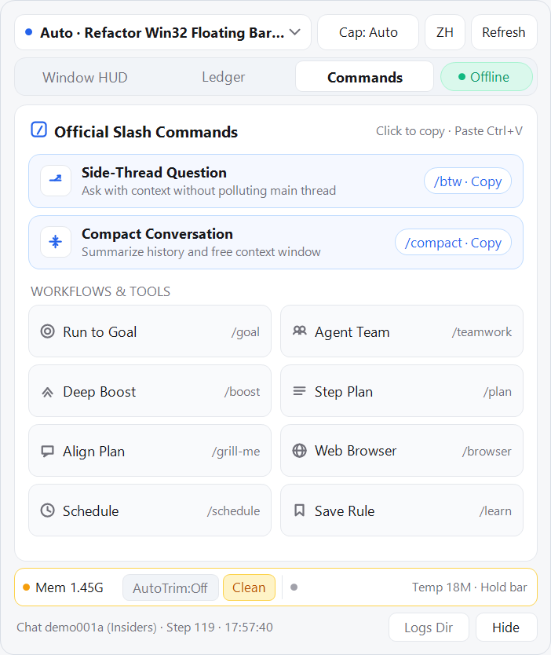
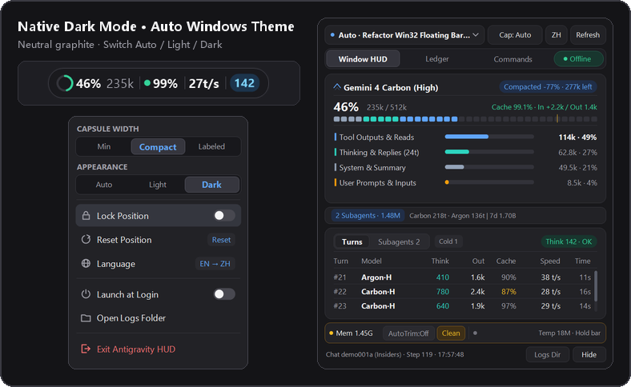

# Antigravity HUD

**A tiny Windows taskbar capsule for Google Antigravity — see live context usage, prompt cache hit rate, token ledger, and official slash commands without ever touching the client.**

English | [简体中文](README.zh-CN.md)

[](https://github.com/CHANPAJN/antigravity-hud)
[](LICENSE)
[-10B981?style=flat-square)](#how-to-use)

---

## What It Does

The **only reason** this tool exists as an external overlay is to keep your official Google Antigravity client **100% intact and spotless** — no `app.asar` patching, no extra IDE extensions cluttering the sidebar, no OAuth/API key reads, and zero network requests.

It runs as a standalone ~236 KB native Windows app that sits in an open spot on your taskbar and reads only local transcript files across **Antigravity Main, Insiders, and CLI**:

- **At-a-glance capsule**: live context usage ring, prompt cache hit %, speed (`t/s`), and reasoning depth.
- **Click to open 3 clean tabs**:
  1. **Window HUD**: context breakdown, turn-by-turn cache/speed history, and subagent inspection.
  2. **Global Ledger**: offline `Today / Yesterday / 7d / 30d / All` totals, interactive 7-day chart, and model/task drilldown.
  3. **Quick Commands**: one-click **clipboard copy** for official slash commands (`/btw`, `/compact`, `/goal`, `/teamwork`, `/boost`, `/plan`, `/grill-me`, `/browser`, `/schedule`, `/learn`) — never injects keystrokes; auto-highlights `/compact` when context ≥ 75%.
- **Fits anywhere**: long-press (≥ 260 ms) to drag across monitors with edge/taskbar snap; right-click for a native Win11 rounded menu (3 capsule widths, `Auto / Light / Dark` theme following Windows, lock/reset position, `EN / 中文`, and opt-in autostart).

<p align="center">
  
</p>

<p align="center">
  
  &nbsp;
  
  &nbsp;
  
  &nbsp;
  
</p>

<p align="center">
  <br/>
  <sub>Default light mode shown above · Native Windows Dark Mode also built in (follows system theme by default, or switch <code>Auto / Light / Dark</code> anytime in the right-click menu).</sub>
</p>

---

## How to Use

### Option 1: Download Prebuilt Binary

Grab `AntigravityHUD.exe` (plus `SHA256SUMS.txt`) from [GitHub Releases](https://github.com/CHANPAJN/antigravity-hud/releases) and double-click to run. No runtime install required.

### Option 2: Compile Locally in ~1 Second (Zero Dependencies)

Windows 10 / 11 already ships with `csc.exe` (.NET Framework 4.x). You do **not** need Visual Studio, .NET SDK, or Node.js — all 14 plain C# files live under `src/`:

```powershell
git clone https://github.com/CHANPAJN/antigravity-hud.git
cd antigravity-hud

# Compile locally (~1s) and install to %LOCALAPPDATA%\AntigravityHUD (autostart off by default)
powershell -ExecutionPolicy Bypass -File .\scripts\install.ps1

# Optional: also enable launch at Windows login
powershell -ExecutionPolicy Bypass -File .\scripts\install.ps1 -Autostart
```

Or double-click `build.cmd` to build a portable `dist\AntigravityHUD.exe`.

### Clean Uninstall

```powershell
powershell -ExecutionPolicy Bypass -File .\scripts\uninstall.ps1
```

---

## Controls

| Action | Behavior |
| --- | --- |
| **Left-click capsule** | Toggle the 3-tab HUD / Ledger / Commands panel without stealing focus |
| **Long-press (≥ 260 ms) & drag** | Move anywhere across monitors with edge & taskbar snap (hold `Alt` for pixel-level placement) |
| **Right-click capsule** | Switch capsule width (`Min / Compact / Labeled`), theme (`Auto / Light / Dark`), lock/reset position, `EN / ZH`, autostart, exit |
| **Click `EN` / `ZH` in header** | Switch English / Simplified Chinese live |

---

## Transparency & Safety

- **100% Local & Offline**: Reads only `%USERPROFILE%\.gemini\antigravity*\brain\` via `mtime` + incremental byte-offset scanning (< 0.2% idle CPU). Zero outbound HTTP/TCP connections, zero browser cookie / OAuth / API key access, zero client patching.
- **Zero Side Effects by Default**: Slash commands use pure clipboard copy only (no keystroke simulation). Optional memory trim / temp cache cleanup (`tempmediaStorage` & `crashes`) is **off by default**, never kills any process, and never touches transcripts. Config is stored only in `%LOCALAPPDATA%\AntigravityHUD\config.json`.
- **Optional External API Cost Footer (Hidden by Default)**: Append JSON lines to `%USERPROFILE%\.gemini\data\paid_api_ledger.jsonl` (e.g. `{"date":"2026-11-27","model":"gemini-omni-1.2-flash","kind":"video","cost_usd":0.42}`) to view daily/monthly external API spend with zero key access.

---

## macOS & Community Port (Contributors Welcome)

This repository currently focuses on **Windows 10 / 11**. Because I don't own a Mac for real-device testing, I avoided shipping an untested port or wrapping everything in Electron.

If you're on macOS and share the same goal — keeping the official Google Antigravity client spotless — a **native Swift Menu Bar (`NSStatusBar` + `NSPopover`) port** is warmly welcome:

- **Reusable Core Logic**: Local transcript paths (`~/.gemini/antigravity*/brain/`) and parsing/ledger rules can be ported directly from [TelemetryEngine.cs](src/TelemetryEngine.cs) and [Models.cs](src/Models.cs).
- **Shared Ground Rules**: Zero client patching, zero injected extensions, strictly local/offline, zero credential access, and lightweight native UI.
- **How to Collaborate**: Join [Issue #1](https://github.com/CHANPAJN/antigravity-hud/issues/1) — open a PR under `macos/` or build a standalone macOS companion repo; once verified, it will be featured right at the top of this README.

---

## Verification

```powershell
powershell -ExecutionPolicy Bypass -File .\tests\verify.ps1
```

## License & Community

- Licensed under **GPL-3.0-only**. See [LICENSE](LICENSE).
- Community discussion & feedback: [LINUX DO](https://linux.do).
