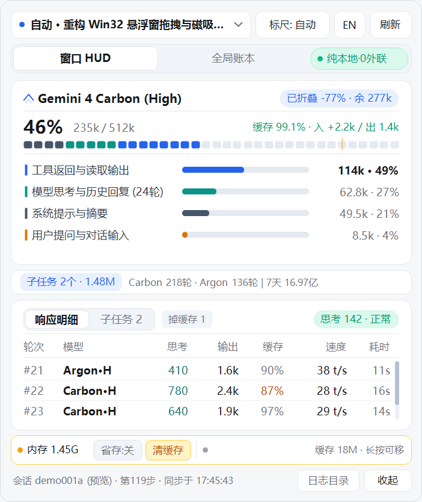
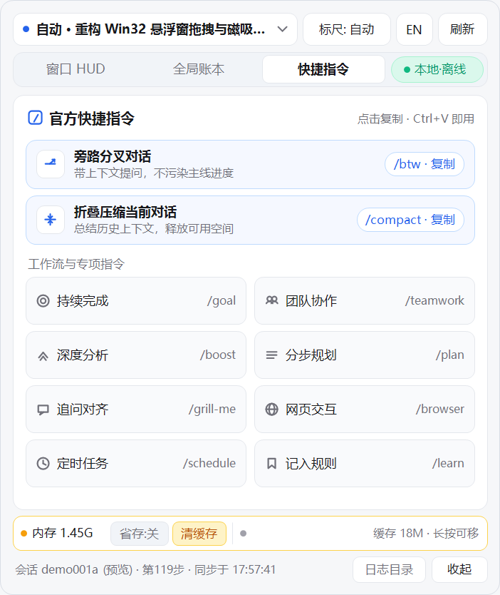
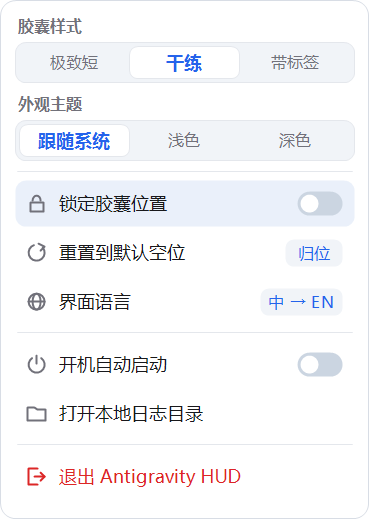
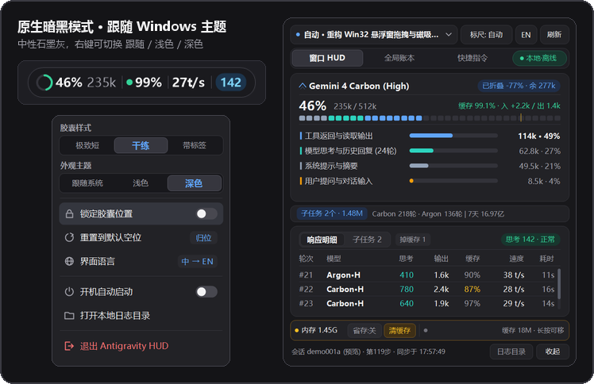

# Antigravity HUD

**专为 Windows 打造的 Google Antigravity 轻量级原生悬浮 HUD 与本地 Token 账本。**

[English](README.md) | 简体中文

[](https://github.com/CHANPAJN/antigravity-hud)
[](LICENSE)
[-10B981?style=flat-square)](#快速开始)

> **仅支持 Windows 10 / 11 · 唯一目的：不改客户端** — 做一个独立外置小工具的**唯一初衷**，就是为了完整保留 Google Antigravity 官方客户端的一尘不染：**绝不修改客户端文件、绝不往界面塞插件、纯本地 0 外联、绝不碰账号凭据**。纯 C# Win32 原生编写，约 236 KB，零第三方依赖。

<p align="center">
  
</p>

<p align="center">
  
  &nbsp;
  
  &nbsp;
  
  &nbsp;
  
</p>

<p align="center">
  <br/>
  <sub>上方为默认清爽浅色模式 · 同时内置原生深色模式（默认自动跟随 Windows 任务栏与应用深浅主题，右键菜单可随时切换 <code>跟随系统 / 浅色 / 深色</code>）。</sub>
</p>

---

## 核心特性

- **不污染官方客户端**：不改 `app.asar`、不往聊天界面塞冗余插件栏，保持官方客户端原汁原味一尘不染，同时通吃 Antigravity 主端、Insiders 与 CLI。
- **悬浮胶囊条（智能寻空位停靠 + 长按自由移动）**
  - **智能寻空位默认停靠**：自动识别 Windows 11 居中任务栏 / 左对齐任务栏及天气小组件开关——Win11 居中任务栏优先停靠**左侧空闲区**（避开右下角拥挤的托盘通知）；Win10 或左对齐任务栏自动寻找右侧空位；**小屏笔记本任务栏空隙不足时自动上浮至任务栏正上方**，绝不遮挡任务栏图标。
  - **短按左键**：原地展开 / 收起详细 HUD 与账本面板，不抢占 Antigravity 输入焦点。
  - **长按（≥ 260ms）或拖动**：可将胶囊自由移动到屏幕任意位置或任意副屏显示器。
  - **现代 Win11 圆角右键菜单**：内置三段式胶囊宽度切换（`极致短 / 干练 / 带标签`）与三段式外观主题切换（`跟随系统 / 浅色 / 深色`）、锁定位置滑块开关、一键归位、中英切换、开机自启开关与日志目录直达。
- **原生浅色 / 暗黑双主题**
  - 默认 **`跟随系统`**（实时监听 Windows 任务栏与应用深浅主题切换：胶囊跟随任务栏深浅，面板与菜单跟随应用深浅），暗黑模式采用中性石墨灰，拒绝刺眼深蓝霓虹；也可在右键菜单随时手动锁定浅色或深色。
  - **智能边缘与任务栏磁吸**：拖动时自动吸附屏幕四边及 Windows 任务栏垂直中轴线（按住 `Alt` 拖动可临时关闭磁吸精调）。
  - **左右锚点防漂移**：自动记录停靠在屏幕左半区或右半区并持久化到 `%LOCALAPPDATA%\AntigravityHUD\config.json`，当胶囊文字动态伸缩时保持贴边不漂移、不出屏。
  - **弹窗四向智能避让**：默认向胶囊上方展开；若胶囊被拖至屏幕顶部，面板自动向下方翻转展开，并自适应所在显示器工作区边界。
  - **一键锁定 / 复位**：右键菜单支持「锁定胶囊位置」防误拖，以及「重置到默认任务栏位置」一键归位。
- **窗口 HUD（当前会话实时监控）**
  - 自动跟随当前激活的 Google Antigravity / Antigravity Insiders / Antigravity CLI 窗口。
  - 实时显示上下文进度环（支持 `自动` / `256K` / `1M` 标尺）、Prompt 缓存命中率、生成速度（`t/s`）、思考深度、上下文构成拆解（工具返回 / 思考与回复 / 系统规则 / 用户输入）、逐轮响应明细及子任务透视。
- **全局账本（纯本地离线多周期统计）**
  - 基于本地会话日志汇总 `今日` / `昨日` / `7天` / `30天` / `全部` 消耗。
  - 内置近 7 日可交互柱状图、按主力模型 / 按会话任务排行（自动合并关联子任务）、点击模型行下钻分析各对话与高频工具分布。
- **快捷指令（官方斜杠命令 · 纯剪贴板复制零侵入）**
  - 第 3 页收纳全部官方斜杠命令（`/btw`、`/compact`、`/goal`、`/teamwork`、`/boost`、`/plan`、`/grill-me`、`/browser`、`/schedule`、`/learn`），免切中英输入法、免背英文拼写。
  - **严格只写系统剪贴板、绝不做模拟按键注入**：点一下即复制并自动收起交回焦点，按 `Ctrl+V` 即可使用；当上下文占用达到 `≥ 75%` 时自动联动提醒 `/compact` 一键折叠。
- **中英双语（自动跟随系统 + 一键热切）**
  - 首次启动自动识别 Windows 系统语言，面板顶栏与右键菜单均可一键切换 `简体中文 / English`。
- **可选内存与临时缓存辅助（默认全关）**
  - 只读展示 Antigravity 工作集内存占用；自动省存与缓存清理默认处于**关闭状态**，仅在用户主动点开或手动点击时生效。

---

## 快速开始

### 方式一：零依赖源码一键本地编译安装（推荐）

Windows 10 / 11 系统已原生自带 `.NET Framework 4.x` 编译器（`csc.exe`），**无需安装 Visual Studio、.NET SDK 或 Node.js**。

```powershell
git clone https://github.com/CHANPAJN/antigravity-hud.git
cd antigravity-hud

# 1 秒本地编译并安装到 %LOCALAPPDATA%\AntigravityHUD
powershell -ExecutionPolicy Bypass -File .\scripts\install.ps1

# 可选：同时开启开机自启（默认不写启动项）
powershell -ExecutionPolicy Bypass -File .\scripts\install.ps1 -Autostart
```

也可以直接双击根目录 `build.cmd`，1 秒编出约 215 KB 的绿色单文件 `dist\AntigravityHUD.exe` 直接运行。

### 方式二：下载 GitHub Releases 预编译版

前往 [GitHub Releases](https://github.com/CHANPAJN/antigravity-hud/releases) 下载由 GitHub 官方 `windows-latest` 流水线自动构建的 `AntigravityHUD.exe` 及 `SHA256SUMS.txt`。

### 干净卸载

```powershell
powershell -ExecutionPolicy Bypass -File .\scripts\uninstall.ps1
```

自动优雅关闭运行中的实例，清理启动项、开始菜单快捷方式、程序与配置文件（如需保留位置配置，可追加 `-KeepConfig`）。

---

## 交互操作速查

| 操作 | 效果 |
| --- | --- |
| **左键短按胶囊** | 展开 / 收起详细 HUD 与全局账本面板 |
| **左键长按（≥ 260ms）并拖动** | 自由移动到当前屏或副屏任意位置（带边缘与任务栏磁吸） |
| **拖动时按住 `Alt`** | 临时关闭磁吸，进行像素级微调 |
| **右键点击胶囊** | 锁定位置、重置到默认任务栏位置、切换中/英、释存清理、开关开机自启、退出 |
| **点击顶栏 `EN` / `ZH`** | 实时切换英文 / 简体中文界面 |
| **按 `Esc` 或点击空白处** | 收起已展开的面板 |

---

## 工作原理与透明说明（Operational Transparency）

仓库全部为纯明文 C# 源码（零二进制黑盒），所有行为透明可审计：

1. **纯本地只读日志解析（0 外联、0 改包）**：
   - 仅只读解析本机 Antigravity 标准会话目录：
     - `%USERPROFILE%\.gemini\antigravity\brain\`
     - `%USERPROFILE%\.gemini\antigravity-insiders\brain\`
     - `%USERPROFILE%\.gemini\antigravity-cli\brain\`
   - 采用文件 `mtime` + 增量偏移读取，空闲时磁盘与 CPU 开销极低。
   - **不发起任何网络请求**，不读取任何账号凭据、Cookie 或 API Key，不修改客户端 `app.asar` 或可执行文件。
2. **窗口联动与多屏全屏避让**：
   - 通过标准 Win32 `SetWinEventHook(EVENT_SYSTEM_FOREGROUND)` 与 `GetWindowText` 感知当前活跃的 Antigravity 窗口实现自动切窗。
   - 仅当胶囊**当前所在的显示器**出现独占全屏程序时才自动隐藏，副屏看视频不影响主屏显示。
3. **副作用全部默认关闭（Opt-In Only）**：
   - **配置文件**：仅保存在 `%LOCALAPPDATA%\AntigravityHUD\config.json`。
   - **开机自启**：默认关闭，仅在传 `-Autostart` 或右键勾选「开机自动启动」时写入当前用户的 `HKCU\Software\Microsoft\Windows\CurrentVersion\Run`。
   - **自动省存与缓存清理**：「省存」开关默认 **`关`**；仅在用户主动开启或手动点击「清缓存 / 释存」时，才清理 Antigravity 目录下的 `tempmediaStorage` 与 `crashes` 临时文件，并调用标准 Win32 `EmptyWorkingSet` 修剪工作集。**绝不终止任何进程，绝不删除任何对话日志**。
4. **平台边界**：
   - 主仓当前专注 **Windows 10 / 11** 原生 Win32 体验（依赖分层窗口与任务栏外壳 API）；欢迎 macOS 开发者参考下方说明一起共创原生 Swift 菜单栏版。

---

## 关于 macOS / 诚邀原生版共创

目前主仓库专注把 **Windows 10 / 11** 的 Win32 原生悬浮体验打磨到位。因为手头没有 Mac 真机，不希望在没法真机实测的情况下盲写半成品，所以没有强行套 Electron 做跨平台。

如果你是 macOS 用户，同样喜欢保持官方 Antigravity 客户端一尘不染，非常欢迎一起共创 **原生 Swift 菜单栏版（Menu Bar + Popover）**：

- **日志与数据结构可直接复用**：macOS 端本地会话目录同样在 `~/.gemini/antigravity*/brain/`，增量解析与统计逻辑可直接参考 [TelemetryEngine.cs](src/TelemetryEngine.cs) 与 [Models.cs](src/Models.cs)。
- **唯一共同约定**：不改客户端文件、不塞插件、纯本地 0 外联、不碰账号凭据、尽量原生轻量。
- **两种共创方式都欢迎**：
  1. 直接向本仓库提交 PR（放到独立的 `macos/` 目录）；
  2. 或者你单独维护一个 macOS 仓库，发 Issue 告诉我，实测通过后会直接挂到本页顶部作为官方推荐的 macOS 姊妹版。

---

## 可选进阶：外部付费 API 离线费用账本（绝不碰密钥）

如果你在使用 Antigravity 订阅的同时，还通过自有 API Key 调用外部付费接口（例如 Gemini API 生图/生视频/TTS 或自定义脚本），Antigravity HUD 支持在底栏右侧**按需自动显示当日与本月 API 费用**——**默认完全隐藏**，100% 纯本地只读，绝不读取任何 API Key、不发起任何网络请求。

只需让你的调用脚本向 `%USERPROFILE%\.gemini\data\paid_api_ledger.jsonl` 追加一行 JSON 记录：

```json
{"date":"2026-11-27","model":"gemini-omni-1.2-flash","kind":"video","cost_usd":0.42}
```

可选字段：`op_id`（幂等去重）、`ts`（时间戳）、`cid`（关联到对应会话 ID 显示单窗消耗）。若本机无此文件，底栏自动隐藏不占任何版面。

---

## 本地编译与自动化校验

```powershell
powershell -ExecutionPolicy Bypass -File .\tests\verify.ps1
```

自动校验零依赖源码编译、配置文件持久化测试（`--test-config`）以及中英双语脱敏离屏渲染输出。

---

## 开源协议

基于 **GPL-3.0-only** 协议开源，完整条款见 [LICENSE](LICENSE)。
