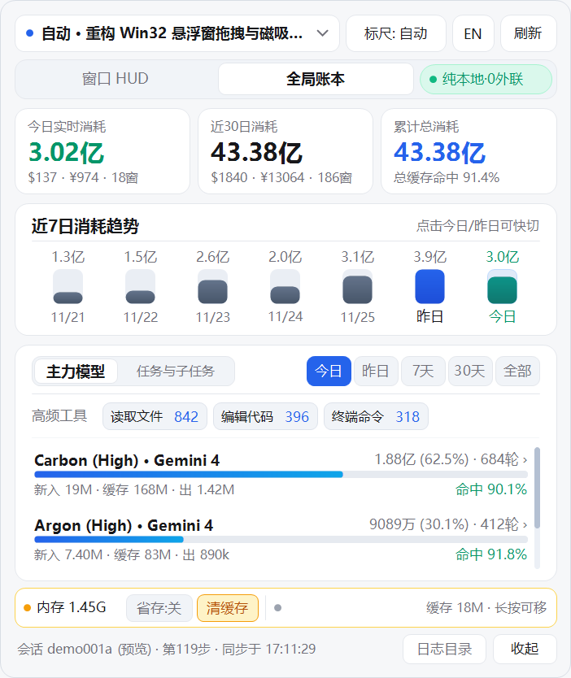

# Antigravity HUD

**给 Google Antigravity 用的 Windows 任务栏小胶囊：不用改官方客户端、不用装插件，直接看上下文进度、缓存命中、Token 消耗和快捷指令。**

[English](README.md) | 简体中文

[](https://github.com/CHANPAJN/antigravity-hud)
[](LICENSE)
[-10B981?style=flat-square)](#怎么用)

---

## 它是干嘛的？

很多用反重力（Antigravity）的朋友喜欢官方客户端干干净净、一尘不染的样子——不想为了看上下文用了多少，往客户端里塞一堆插件，更不想改 `app.asar` 或把账号凭据交给第三方。

做这个小工具的**唯一目的，就是不改官方客户端**。它是一个完全独立的外置 Windows 小程序（约 236 KB），只读本机日志文件，全程断网不外联，自动跟在任务栏空位上：

- **一眼看当前对话**：上下文用了百分之多少、缓存命中率、生成速度、思考量（同时支持主端 / Insiders / CLI）。
- **点开看三页**：
  1. **窗口 HUD**：当前窗口上下文构成拆解、每轮耗时与缓存命中、子任务明细。
  2. **全局账本**：今日 / 昨日 / 7天 / 30天消耗统计、7日柱状图、按模型和任务排行。
  3. **快捷指令**：内置 `/btw`、`/compact`、`/boost`、`/plan` 等 10 个官方斜杠命令，点一下只复制到剪贴板，不注入客户端，切回输入框 `Ctrl+V` 即用。
- **随手怎么顺手怎么放**：长按胶囊 0.3 秒就能拖去任意屏幕或角落（带磁吸），右键圆角菜单切 3 档宽度、浅色/暗黑模式（默认自动跟随系统）、锁定位置、中英文和开机自启。

<p align="center">
  
</p>

<p align="center">
  
  &nbsp;
  
  &nbsp;
  
  &nbsp;
  
</p>

<p align="center">
  <br/>
  <sub>上方为默认清爽浅色模式 · 同时内置原生深色模式（默认自动跟随 Windows 系统深浅色，右键可随时手动切 <code>跟随系统 / 浅色 / 深色</code>）。</sub>
</p>

---

## 怎么用？（30 秒上手）

### 方式一：直接下载运行（最省事）

去 [GitHub Releases](https://github.com/CHANPAJN/antigravity-hud/releases) 下载 `AntigravityHUD.exe`（由本仓库 GitHub Actions 自动编译，附 `SHA256SUMS.txt`），双击直接跑，不需要安装任何运行库。

### 方式二：自己从源码 1 秒编译（不放心 exe 就自己编）

Windows 10 / 11 自带 `.NET Framework 4.x` 编译器（`csc.exe`），**不用装 Visual Studio、.NET SDK 或 Node.js**，全部 14 个明文 `.cs` 文件就在 `src/` 目录里：

```powershell
git clone https://github.com/CHANPAJN/antigravity-hud.git
cd antigravity-hud

# 1 秒编译并安装到 %LOCALAPPDATA%\AntigravityHUD（默认不写开机自启）
powershell -ExecutionPolicy Bypass -File .\scripts\install.ps1

# 如果需要顺便打开开机自启，加上 -Autostart
powershell -ExecutionPolicy Bypass -File .\scripts\install.ps1 -Autostart
```

也可以直接双击根目录的 `build.cmd`，1 秒编出绿色单文件 `dist\AntigravityHUD.exe`。

### 干净卸载

```powershell
powershell -ExecutionPolicy Bypass -File .\scripts\uninstall.ps1
```

---

## 常用操作

| 操作 | 效果 |
| --- | --- |
| **左键点一下胶囊** | 展开 / 收起详情面板（不抢反重力焦点） |
| **左键长按（≥ 0.3 秒）拖动** | 自由拖到当前屏或副屏任意位置（靠近边缘自动磁吸，按住 `Alt` 精调） |
| **右键点击胶囊** | 切 3 档胶囊宽度、切跟随系统/浅色/深色、锁定位置、归位、切中英文、开关开机自启、退出 |
| **点击顶栏 `EN` / `ZH`** | 实时切换中英文界面 |

---

## 安全与工作原理（全透明）

- **纯本地只读，0 网络请求**：只读本机 `~/.gemini/antigravity*/brain/` 下的对话日志（支持主端、Insiders、CLI），增量读取，空闲 CPU 低于 `0.2%`。不发任何网络请求，不读浏览器 Cookie、OAuth Token 或 API Key，不修改客户端任何文件。
- **不模拟按键、不杀进程**：「快捷指令」页只做剪贴板复制；「自动省存 / 清缓存」默认关闭，仅在你主动点击或开启时清理 Antigravity 的 `tempmediaStorage` / `crashes` 临时文件并调用系统 `EmptyWorkingSet`，绝不杀任何进程、绝不删对话记录。
- **配置文件位置**：仅保存在 `%LOCALAPPDATA%\AntigravityHUD\config.json`。
- **可选扩展：离线外部 API 费用账本（默认隐藏）**：如果你同时用外部付费 API，往 `%USERPROFILE%\.gemini\data\paid_api_ledger.jsonl` 追加 `{"date":"2026-11-27","model":"gemini-omni-1.2-flash","kind":"video","cost_usd":0.42}`，底栏会自动显示今日/本月开销；无此文件时完全隐藏，绝不碰任何密钥。

---

## 关于 macOS / 诚邀原生版共创

目前主仓库专注把 **Windows 10 / 11** 原生体验打磨到位。因为手头没有 Mac 真机，不想在没法真机实测的情况下云写半成品，也没有为了跨平台硬套一层 Electron。

如果你是 macOS 用户，同样喜欢保持官方 Antigravity 客户端一尘不染，非常欢迎一起共创 **原生 Swift 菜单栏版（Menu Bar + Popover）**：

- **日志路径与解析逻辑通用**：macOS 端本地会话目录同样在 `~/.gemini/antigravity*/brain/`，解析与统计逻辑可直接参考 [TelemetryEngine.cs](src/TelemetryEngine.cs) 和 [Models.cs](src/Models.cs)。
- **共同约定**：不改客户端、不插插件、纯本地 0 外联、不碰账号凭据、尽量原生轻量。
- **参与方式**：欢迎在 [Issue #1](https://github.com/CHANPAJN/antigravity-hud/issues/1) 留言，直接给本仓库提 `macos/` PR 或单独建库都可以，实测通过后会直接置顶挂到本页顶部推荐。

---

## 本地自检

```powershell
powershell -ExecutionPolicy Bypass -File .\tests\verify.ps1
```

## 开源协议与社区

- 本项目基于 **GPL-3.0-only** 协议完整开源，见 [LICENSE](LICENSE)。
- 首发交流与反馈社区：[LINUX DO](https://linux.do)（真诚、友善、团结、专业）。
